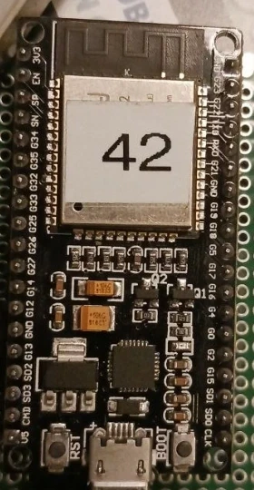
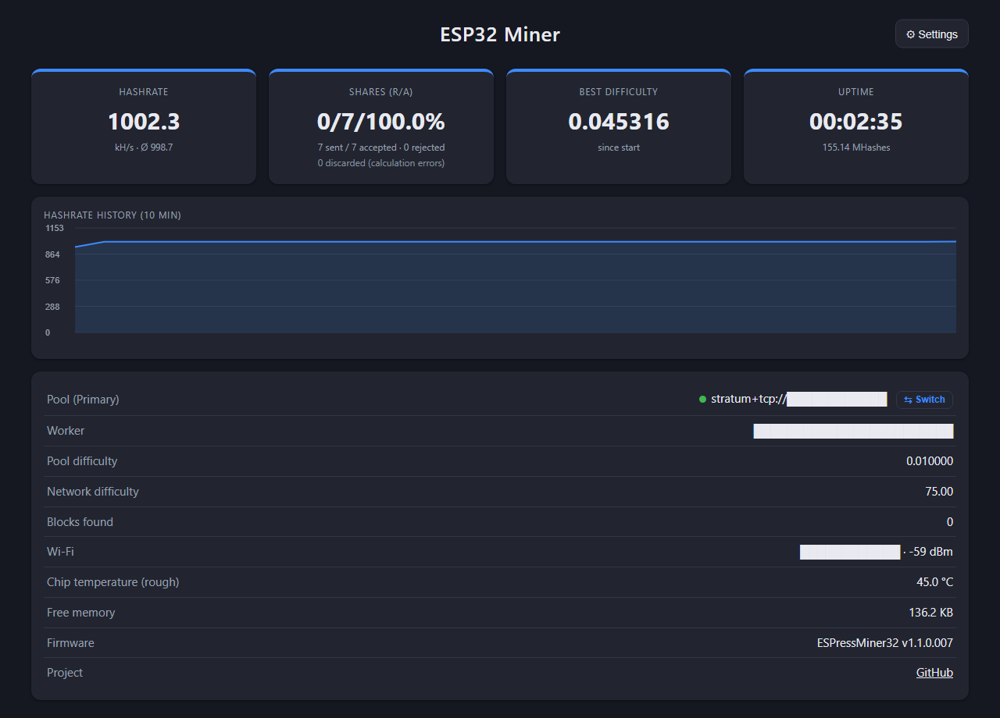
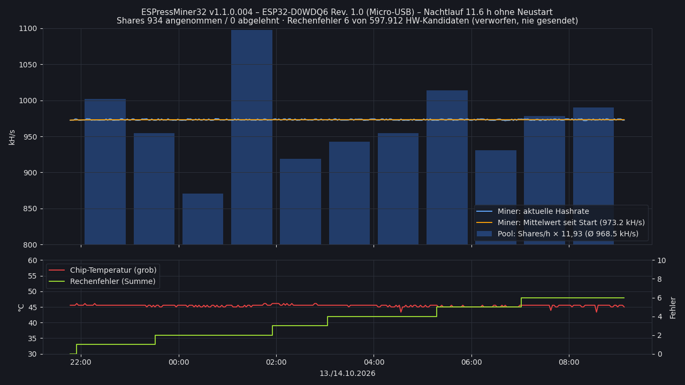
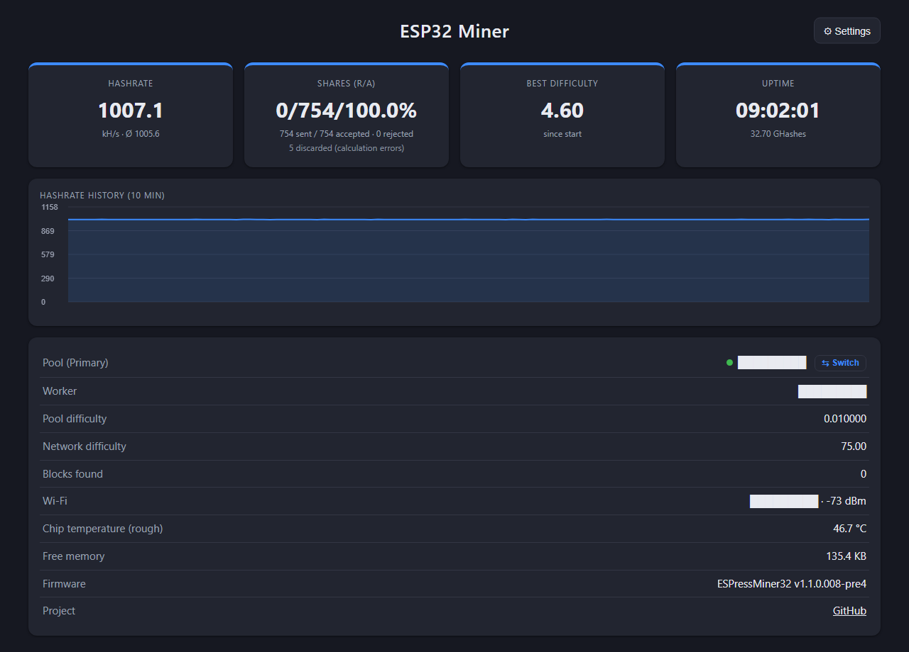
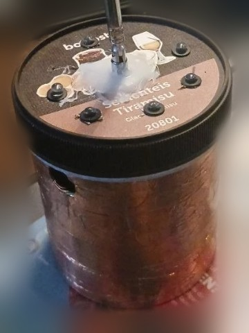
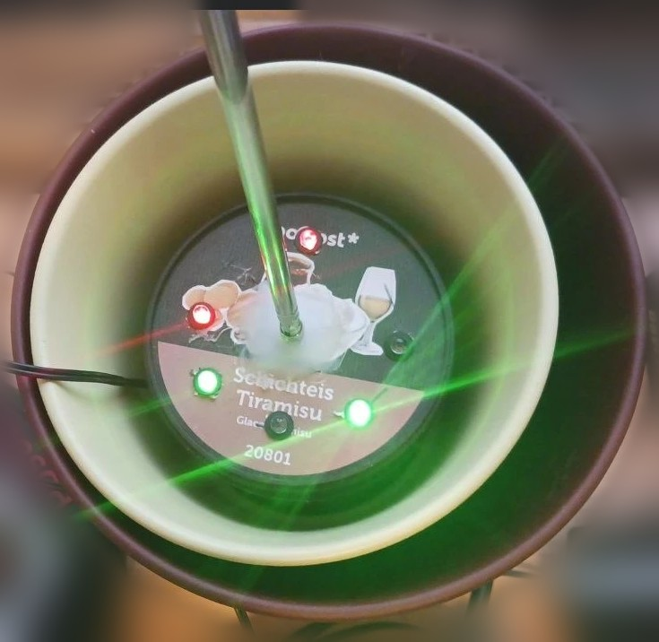
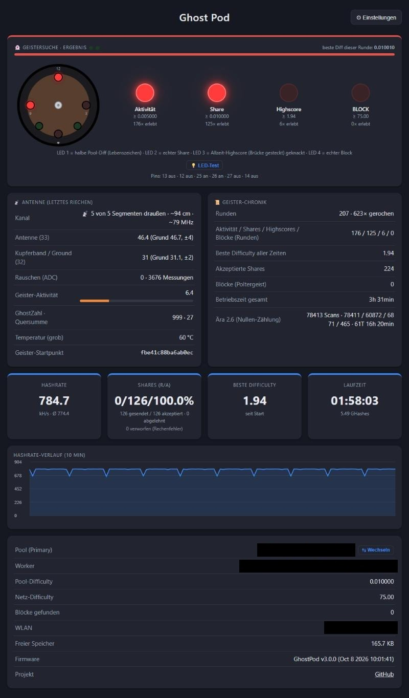

# ☕ ESPressMiner32 – DevKitC 38-Pin (Micro-USB) · 👻 Ghost Pod

🇬🇧 [English](README.md) · 🇩🇪 **Deutsch**

**Ein Code, zwei Bauvarianten** für den älteren ESP32 (Revision 1.0):

| Variante | Was sie ist | PlatformIO |
|---|---|---|
| **ESPressMiner32** | der normale Miner, ~1006 kH/s, optionale LED an GPIO13 | `pio run -e esp32dev -t upload` |
| **👻 Ghost Pod** | der Geisterdetektor im Eisbecher: gleicher Miner + Antennen-Entropie, 4 rote + 2 grüne LEDs, Piepser, Geister-Chronik | `pio run -e ghostpod -t upload` |

Jede Verbesserung am Miner kommt bei beiden an. → [Abschnitt Ghost Pod](#-ghost-pod)

### Neu in 1.1.1.004 / Ghost Pod 3.1.0.004 (Vorabversion, im Test)

- **Firmware-Update über die Weboberfläche** (Settings → Firmware update): `firmware.bin` hochladen, das Mining pausiert,
  die Datei wird geprüft (ESP-Image + Board-Kennung `ESPM32-BOARD:microusb-devkit` / `ESPM32-BOARD:ghostpod`), dann
  Neustart. Eine USB-C-Firmware wird abgelehnt – sie hat keinen Rev.-1-Schutz und würde auf diesem Chip abstürzen.
  **Braucht zwei App-Bereiche:** Partitionstabelle jetzt `min_spiffs.csv` (2 × 1,9 MB) – **einmal komplett per USB**
  flashen (Bootloader, Partitionen, `boot_app0`, App; `pio run -t upload` macht alles). Einstellungen (NVS 0x9000) bleiben.
- Ein Neustart durch **dich** (Save & restart, Update) beginnt bei Betriebszeit 0; nur Abbrüche (WLAN-Wächter, Absturz) übergeben.
- „Save Wi-Fi 2“ speichert das zweite WLAN ohne Neustart.
- Gleicher Stand wie das Hauptprojekt v1.3.1.002 (USB-C). Hash-Schleifen unverändert.

### 1.1.1.003 / Ghost Pod 3.1.0.003

- **Betriebszeit übersteht Neustarts:** Nach einem Neustart *ohne* Stromtrennung (WLAN-Wächter, Absturz, Speichern der
  Einstellungen) laufen Betriebszeit, Best Diff und Blockfunde weiter; Shares beginnen bei 0. Nach einer Stromtrennung
  beginnt alles bei 0 – an der Betriebszeit sieht man also, ob das Gerät durchgelaufen ist. Dashboard: `↻1` = ein Neustart.
- **Zweites WLAN (optional):** wird versucht, wenn WLAN 1 nicht erreichbar ist (beim Start, bei Verbindungsverlust, bei
  offenem Portal). Auf WLAN 2 prüft der Miner alle 10 min, ob WLAN 1 wieder da ist, und geht dorthin zurück.
- **Tausch-Knöpfe, dauerhaft gespeichert, ohne Neustart:** „⇅ Swap Wi-Fi 1 & 2“ und „⇅ Swap pools“ (in den
  Einstellungen und im Dashboard). Der alte „Switch“ schaltete nur bis zum nächsten Neustart um.
- **Schnell-Setup:** Im Einrichtungs-Portal reicht das WLAN – Pool und Wallet später bequem am PC eintragen.
- **Aufklappbare Einstellungen** (General · Wi-Fi 1 · Wi-Fi 2 · Primary · Secondary · Pool switching); der Miner merkt
  sich, was offen ist – Handy und PC sehen gleich aus.
- **Ghost Pod 3.1:** wird jetzt aus diesem Code gebaut – ~1003 statt 786 kH/s, alle Geister-Funktionen unverändert, Oberfläche Englisch.

Ein Bitcoin-Stratum-Miner (V1) für den **klassischen ESP32**. Er nutzt den **SHA-256-Hardwarebeschleuniger**
per direktem Registerzugriff mit einer Pipeline: Die Daten für den nächsten Block werden geschrieben,
während die Engine noch rechnet.

Variante für das ältere **ESP32-DevKitC mit 38 Pins** (Nachbau, ESP-WROOM-32, ESP32-D0WDQ6 **Revision 1.0**,
CP2102, Micro-USB; erkennbar an **3V3 und GND ganz oben** links/rechts neben der Antenne)

<p align="center"><br>
<sub>Das ältere Board: <b>Micro-USB</b>, 3V3/GND ganz oben, G13 neben GND. Läuft die Firmware auf einem
anderen ESP32 mit Rev.-1-Chip, greift der Fix genauso – die Revision wird automatisch erkannt.</sub></p>
mit optionaler externer **LED an GPIO13**.

> 💡 **LED ist optional** – der Miner läuft auch ohne. Wer eine möchte:
> GPIO13 → Vorwiderstand 220–330 Ω → LED-Anode (langes Bein), Kathode → GND.
> GPIO13 wurde gewählt, weil **G13 auf diesem Board direkt neben einem GND-Pin** (zwischen G12 und G13) liegt – eine LED
> mit Vorwiderstand lässt sich so einfach auf die beiden Nachbar-Pins stecken.
> Anderer Pin: `LED_PIN` in `include/config.h` ändern (`-1` = keine LED).
> Verhalten: blinkt langsam im Einrichtungs-Portal, leuchtet beim Minen, kurz aus bei jedem Share.

Gemessen auf ESP32-D0WDQ6 Rev. 1.0 @ 240 MHz, **v1.1.0.007: ~1000 kH/s** (Hardware 969 + Software-Miner 31,
247 Takte pro Double-SHA256). Vorher (v1.0.0): 786 kH/s → **+27 %**.
**Aktuelle Version v1.1.1 (getestet): ~1006 kH/s** (Hardware 971,8 + Software 33,1).
Nachtlauf 9,0 h: Ø **1005,6 kH/s**, nie unter 1003, **0 Neustarts, 753/753 Shares angenommen, 5 Rechenfehler**
(~1 auf 96.000 Treffer). **Am Pool nachgeprüft:** 987 ±38 kH/s kamen über 8 volle Stunden dieser Nacht an.

> **1000 kH/s auf einem ESP32 Rev. 1.0** – trotz des Errata-3.10-Schutzes, den auf diesem alten Chip jeder Hash braucht.
Auf ESP32-D0WD-V3 (Revision 3) nimmt dieselbe Firmware automatisch die Schleife ohne Schutz (~1019 kH/s im Hauptprojekt).

<p align="center"><br>
<sub>Dashboard des Testboards (ESP32 Rev. 1.0) mit v1.1.0.007 bei ~1000 kH/s – Pool, Worker und WLAN geschwärzt.
Nachtlauf mit v1.1.0.004 (11,1 h, Ø 973,2 kH/s): <a href="docs/nachtlauf_v1.1.0.004.png">Diagramm</a>.
Konsolen-Ausgabe beim Start (Chip-Revision, Selbsttest, Benchmark): <a href="docs/konsole_v1.1.0.001.log">docs/konsole_v1.1.0.001.log</a></sub></p>

> **Der Rev.-1-Fehler:** ESP32 bis Revision 1.x haben einen Hardwarefehler (Espressif-Errata 3.10):
> Liest ein Kern ein DPORT-Register (dort liegt der SHA-Beschleuniger), während der andere Kern
> APB-Register liest, bekommt der andere Kern falsche Daten. Folge: `wifi assert` und
> Watchdog-Neustart direkt nach Mining-Beginn. Die Firmware erkennt die Chip-Revision beim Start und
> liest den SHA-Puffer dann mit der geschützten Sequenz aus ESP-IDF (Interrupts sperren → Dummy-Lesen auf APB →
> SHA-Register lesen).
>
> **Neu in v1.1.0.001:** Die schnelle Hash-Schleife v2 (aus NerdMiner Modded) liest pro Nonce nur **ein** Wort (H7)
> aus dem SHA-Puffer. Das Hauptprojekt schaltet sie auf alten Chips trotzdem ab. Hier gibt es eigene Varianten, die
> genau dieses eine Lesen schützen. Kosten: ~19 Takte pro Hash (259 statt 240) statt ~13 % wie in v1.0.0.

### Nachtlauf (v1.1.0.004)

Testboard (ESP32-D0WDQ6 Rev. 1.0) am eigenen Stratum-Pool, Software-Miner an, Protokoll alle 2 Minuten über
`/api/stats` (`tools/miner_logger.py`). 13./14.10.2026, 21:46–08:55 Uhr:

| | Wert |
|---|---|
| Dauer | **11,1 h**, 335 Messpunkte, **0 Neustarts** |
| Hashrate | **Ø 973,2 kH/s**, Spanne nur 971,8–974,5 |
| Shares beim Pool angekommen | 890 in 11 h → **~965 kH/s echte Arbeit** (±3 % statistische Schwankung) |
| Rechenfehler (verworfen) | **6 von 587.751** Kandidaten (~0,001 %), keiner ging an den Pool |
| Chip-Temperatur (grob) | 43–46 °C, Überhitzungsschutz nie ausgelöst |

Zum Vergleich in derselben Nacht am selben Pool: fünf NerdMiner zwischen 959 und 999 kH/s.

<p align="center"><br>
<sub>Verlauf der Nacht (bis 09:07): Hashrate laut Miner, Shares je Stunde am Pool (× 11,93 = kH/s), Chip-Temperatur und
verworfene Rechenfehler. Rohdaten aller Messpunkte: <a href="docs/nachtlauf_v1.1.0.004.csv">docs/nachtlauf_v1.1.0.004.csv</a></sub></p>

### Langzeittest (v1.0.0)

Ein Board dieser Variante läuft im Dauerbetrieb (Außengehäuse, WLAN über Repeater) am öffentlichen Pool
hmpool.io. Stand nach **13 h 26 min** ohne Neustart (Oktober 2026):

| | Wert |
|---|---|
| Hashrate | **786 kH/s**, konstant (Schnitt 786,1) |
| Hashes gesamt | 38,0 Mrd. |
| Shares erwartet (bei Pool-Difficulty 0,01) | 885 |
| Shares gesendet / angenommen / abgelehnt | 874 / 873 / 0 |
| Abweichung | **−1,3 %** (bei 885 Shares liegt die statistische Schwankung bei ±3,4 %) |
| Rechenfehler (vom Dashboard gezählt) | 19 |

**Die angezeigte Hashrate stimmt also mit der Arbeit überein, die tatsächlich beim Pool ankommt.**

**Zu den 19 Rechenfehlern:** Um diese Geschwindigkeit zu erreichen, wird der SHA-Baustein nicht nach
Datenblatt betrieben (Schreiben, während er rechnet, feste Wartezeiten statt BUSY-Abfrage). Dabei rechnet er
gelegentlich falsch. Das Dashboard zählt nur die falschen Hashes, die zufällig wie ein Treffer aussehen
(etwa einer von 65.536). Hochgerechnet sind 19 davon in 13 Stunden **etwa 1 falscher Hash je 30.000, also
~0,003 %**. Jeder Treffer wird vor dem Senden in Software nachgerechnet, **ein falscher Hash geht nie an den
Pool**. Auf den Ertrag hat das keinen messbaren Einfluss.

🔗 **Projektseite:** https://github.com/brenner23/ESPressMiner32-MicroUSB-GhostPod  
🔗 **Hauptprojekt (USB-C, Rev. 3):** https://github.com/brenner23/ESPressMiner32

> ⚠️ **Hobbyprojekt.** Mit einem ESP32 findet man realistisch keinen Bitcoin-Block. Es geht ums Lernen,
> Basteln und Ausreizen der Hardware. Ideal für Solo-Pools, Lotterie-Mining oder den eigenen Test-Pool.

---

## Funktionen

- **~1006 kH/s** auf ESP32 Rev. 1.0 (v1.1.1, getestet), Rev. 3 ohne Schutz schneller – Revision wird automatisch erkannt
- **Hash-Schleife v2** in Assembler (portiert aus NerdMiner Modded), Auswahl per Known-Answer-Test mit Rückfallstufen
- **Software-Miner auf Core 0** zusätzlich (~31 kH/s, ~33 kH/s mit dem schnellen Scan ab v1.1.0.008-pre3)
- **Chip-Temperatur** im Dashboard, **Überhitzungsschutz** (90 °C SW-Miner Pause, 100 °C Stopp, weiter unter 80 °C)
- **Selbsttest** beim Start (Genesis-Block, 2000 Zufalls-Header, 5000 Nonces). Schlägt er fehl, wird nicht gemint.
- **Jeder Treffer wird in Software nachgerechnet**, bevor ein Share zum Pool geht
- **WLAN-Wächter** (v1.1.0.006): nach 10 s ohne WLAN neu verbinden (Suche über alle Kanäle, z. B. nach einem
  Kanalwechsel im Mesh), nach 3 min offline Neustart
- **Schutzfenster** (v1.1.0.006): stört ein Gerät im Netz den ESP32 in festem Takt (auf dem USB-C-Board Fehler-Schübe
  alle ~600 s), lernt der Miner den Takt und rechnet ein paar Sekunden um den Zeitpunkt herum mit einer vorsichtigeren Schleife
- **Web-Dashboard** unter `http://espressminer.local/` mit Hashrate-Verlauf, JSON unter `/api/stats` – Oberfläche und Konsole auf Englisch (ab v1.1.0.005)
- **Primary- und Secondary-Pool** mit automatischem Wechsel (3 Fehlversuche → Secondary, nach 10 min zurück zum Primary),
  Knopf **⇅ Swap pools** (gespeichert, ohne Neustart)
- **Zwei WLANs** (zweites optional, wird mitgeprüft wenn WLAN 1 fehlt, nach 10 min zurück zu WLAN 1)
- **Neustart-Übergabe:** Betriebszeit, Best Diff und Blocks laufen bei Neustarts ohne Stromtrennung weiter
- **Einrichtung ohne Programmieren:** WLAN-Portal, Setup-Programm mit Oberfläche oder Kommandozeile
- **Optionale LED an GPIO13** leuchtet beim Minen und blinkt bei jedem Share

## Projektstruktur

```
ESPressMiner32/
├── platformio.ini            Build-Konfiguration (240 MHz, -O2)
├── include/
│   ├── credentials.h         Startwerte (leer, optional)
│   ├── config.h              Difficulty, Cores, LED, Nonce-Bereiche
│   ├── sha256_hw.h           Hardware-SHA-Pipeline, Auswahl der Hash-Schleife
│   ├── sha256_sw.h           Software-SHA-256 (Coinbase, Merkle, Prüfung)
│   ├── stratum_client.h      Stratum-V1-Client
│   ├── mining_job.h          Job-/Share-Austausch zwischen den Tasks
│   └── ...
├── src/                      Implementierungen zu den Headern + main.cpp
│   ├── hw_scan_v2.S          Hash-Schleife v2 (NerdMiner Modded, MIT) + Varianten J und *_df (Rev. 1)
│   └── sha256_hw.cpp         Treiber, Errata-3.10-Schutz, Known-Answer-Test, Laufzeit-Kontrolle
├── CHANGELOG.md              Versionen
├── MESSPROTOKOLL.md          Messwerte je Schritt
├── tools/                    Setup per USB: espressminer_setup_gui.py (Oberfläche), espressminer_setup.py
└── test/hw_probe/            Messprogramm für den SHA-Beschleuniger (Entwicklung)
```

## Bauen & Flashen (VS Code + PlatformIO)

1. Ordner in VS Code öffnen (die PlatformIO-Erweiterung wird vorgeschlagen).
2. ESP32 per USB anschließen. PlatformIO findet den COM-Port automatisch.
3. Unten in der Statusleiste **→ Upload** (bzw. `pio run -t upload`).
4. **Serial Monitor** (115200 Baud) zeigt Selbsttest, Benchmark und alle 5 s die Hashrate.

Zugangsdaten müssen nicht in den Code: `include/credentials.h` ist absichtlich leer, eingerichtet wird nach dem Flashen.

## Ersteinrichtung (nach dem Flashen)

Solange keine Einstellungen gespeichert sind, startet der Miner **nicht** zum Minen, sondern wartet auf die Einrichtung.

**1. WLAN-Portal (Handy/Laptop)**
Mit dem WLAN `ESPressMiner32-XXXX` (Passwort `espressminer`; Ghost Pod: `GhostPod-XXXX` / `ghostpod`) verbinden.
Die Einrichtungsseite öffnet sich automatisch, sonst `http://192.168.4.1/` aufrufen. **Das WLAN reicht** – der Miner
startet neu, geht ins Netz, Pool und Wallet trägt man danach am PC in den Dashboard-Einstellungen ein.
Das Portal startet auch, wenn kein gespeichertes WLAN 20 s lang erreichbar ist. Es löscht nie etwas: Ist das WLAN
wieder da, verbindet sich der Miner mit den gespeicherten Daten (auch nach Strom aus/an).

**2. Setup-Programm mit Oberfläche** (`pip install pyserial`)
```
python tools/espressminer_setup_gui.py
```
COM-Port wählen, Felder ausfüllen (oder „JSON laden …“), „Speichern & Neustart“.
Vorlage für mehrere Miner: `tools/credentials.example.json`.

**3. Kommandozeile über USB**
```
python tools/espressminer_setup.py                 # interaktiv, COM-Port wird gesucht
python tools/espressminer_setup.py --port COM3 --get
python tools/espressminer_setup.py --ssid MeinWLAN --password geheim ^
       --pool stratum+tcp://pool.example.com:3333 --wallet ADRESSE.Worker -y
python tools/espressminer_setup.py --reset         # Einstellungen löschen -> Portal
```

**4. Serielle Konsole direkt** (115200 Baud), eine JSON-Zeile pro Befehl, Antworten beginnen mit `@CM `:
```
{"cmd":"info"}   {"cmd":"get"}   {"cmd":"reset"}   {"cmd":"restart"}
{"cmd":"set","hostname":"espressminer","wifiSsid":"...","wifiPass":"...",
 "pools":[{"url":"stratum+tcp://host:3333","user":"ADRESSE.Worker","pass":"x"},{"url":""}]}
```

**Zurücksetzen ohne PC:** BOOT-Taste 5 s gedrückt halten → Einstellungen gelöscht, Neustart ins Portal (beim Ghost Pod abgeschaltet).

## Ablauf

| Core | Aufgabe |
|------|---------|
| 1 | Hardware-SHA-Miner (exklusiv) |
| 0 | WLAN, Stratum-Client, Web-Dashboard, Statistik |

- **Einstellungen** (Zahnrad „Settings“ im Dashboard): Hostname, WLAN 1 und 2, Primary- und Secondary-Pool, gespeichert im Flash (NVS).
  Nach 3 Fehlversuchen wechselt der Miner zum anderen Pool, vom Secondary aus wird alle 10 Minuten der Primary erneut versucht.
- Das Dashboard läuft auf Core 0 und kostet keine Hashrate.

## Wie die Hashrate zustande kommt

| Schritt | kH/s |
|---|---|
| Einfacher Hardware-Weg (BUSY abfragen) | ~360 |
| Pipeline: nächsten Block schreiben, während die Engine rechnet | ~557 |
| Textregister gepuffert schreiben, ohne `memw` (Idee aus SparkMiner) | ~650 |
| Basisadresse im Register statt `l32r` pro Zugriff | ~700 |
| Feste Wartezeiten statt BUSY (das Flag hängt ~34 Takte nach) | ~800 |
| Kein `memw` nach LOAD | ~833 |
| Wartezeit je Phase einzeln kalibriert | ~842 |
| Software-Pipeline: nächsten Block 1 vor der Kandidatenprüfung starten | ~902 |
| Hash-Schleife v2 aus NerdMiner Modded (gezählte Wartezeiten, Writes ≥ 3 Takte auseinander) | ~963 |
| + Software-Miner auf Core 0 (stört v2 nicht mehr) | ~990 |
| Variante J: Header-Wörter in Registern, Write-Abstand 2 Takte | ~1019 |

Die Werte oben gelten für Rev. 3 (Hauptprojekt). Auf **Rev. 1.0** (diese Variante):

| Stand | kH/s |
|---|---|
| v1.0.0: kalibrierte Pipeline, jedes Lesen geschützt | 786 |
| v1.1.0.001: Variante J, nur das H7-Lesen geschützt | ~950 |
| v1.1.0.002: Schutz in der LOAD-Wartezeit vorbereitet | ~962 |
| v1.1.0.003: Schutz mit den Header-Writes verschachtelt | ~972 |
| v1.1.0.006: gleiche Schleife + WLAN-Wächter und Schutzfenster | ~973 |
| **v1.1.0.007: geschütztes H7-Lesen in die LOAD-Wartezeit verlegt** | **~1000** |
| v1.1.0.008-pre4 (Vorabversion): Interrupts je Charge gesperrt, schneller Software-Scan (im Flash), Fehler aus WLAN-Wellen getrennt angezeigt | ~1006 |
| **v1.1.1 (aktuell, getestet): = pre4 nach 9 h Nachtlauf; Dashboard zeigt nur die Fehler der Schleife (`SHOW_WAVE_ERRORS`)** | **~1006** |
| v1.1.1.003 (Vorabversion): Neustart-Übergabe, WLAN 2, Tausch-Knöpfe, Schnell-Setup – Hash-Schleifen unverändert | ~1006 |
| Ghost Pod 3.1.0.003: gleiche Schleifen (Antenne, LEDs, Piepser auf Core 0) | ~1003 |

### WLAN-Wellen und Schutzfenster

In Langzeittests kamen die restlichen Rechenfehler fast nur als **Schub von 5–8 Fehlern, pünktlich alle ~600 s** –
auf dem USB-C-Board genauso wie auf diesem Rev.-1-Board. Die Ursache liegt nicht im Miner, sondern in der
**WLAN-Verbindung**: Der Takt hängt an der Anmeldung des ESP am WLAN und springt bei einer Neuanmeldung mit. Sehr
wahrscheinlich ist es eine periodische Aktion des Access Points, z. B. der Schlüsselwechsel oder die Mesh-Funktion einer
**Fritzbox**. Je nach Router kann der Takt anders sein oder ganz fehlen.

Das **Schutzfenster** (ab v1.1.0.006) lernt diesen Takt aus den Schüben (1–30 min) und rechnet 6 s vor bis 6 s nach dem
erwarteten Zeitpunkt mit einer vorsichtigeren Schleife. Jedes 6. Fenster bleibt als Stichprobe ungeschützt, damit der
Miner merkt, ob die Welle noch da ist – daher kommen die ~8 Fehler pro Stunde. Nach einem Neustart trifft die erste Welle
ungeschützt, weil der Takt noch nicht bekannt ist.

**Schalter `SHOW_WAVE_ERRORS`** (ganz oben in `include/config.h`, ab v1.1.1):
- `0` (Standard): Dashboard und Konsole zeigen nur die Fehler der Hash-Schleife, z. B. `5 discarded (calculation errors)`.
- `1`: zusätzlich die Fehler aus WLAN-Wellen, z. B. `5 discarded (+8 from 1 Wi-Fi wave)` – praktisch, um das eigene
  Netz zu vermessen.

Gelöscht wird in keinem Fall etwas: `/api/stats` liefert immer `hwErrors` (gesamt), `waveErrors` und `loopErrors`.
Die Trennung ist eine Messhilfe; im Zweifel gilt `hwErrors`. Jeder Treffer wird in Software nachgeprüft – ein falsch
berechneter Treffer wird nie zum Share.

<p align="center"><br>
<sub>Rev.-1.0-Testboard nach dem 9-h-Nachtlauf – Pool, Worker und WLAN geschwärzt.</sub></p>

**So liest man den Screenshot** (getesteter Stand 1.1.0.008-pre4 = 1.1.1, Live-Werte nach 9 h 02 min):
- **5 discarded** = echte Rechenfehler der Hash-Schleife in 9 Stunden (~1 auf 96.000 Treffer); 3 davon in der ersten
  Stunde, während der Chip warm wurde (44 → 47 °C), danach 2 in 8 Stunden.
- **In dieser Nacht kam gar keine WLAN-Welle** – das Testboard hängt an einem Mesh-Knoten, an dem die Fritzbox-Welle
  nicht auftrat. Das Schutzfenster wurde deshalb nie aktiv, die Hashrate-Kurve bleibt flach (beim USB-C-Board zeigt
  sich das Schutzfenster als kleine Delle alle ~600 s; das ist gewollt, kein Fehler).
- Falsche Hashes erreichen nie den Pool: Jeder Treffer wird in Software nachgeprüft (0 abgelehnt).
- **Komplettes Nachtprotokoll** (eine Zeile pro Minute, 9 h, keine privaten Daten): [docs/nachtlauf_v1.1.1.log](docs/nachtlauf_v1.1.1.log) · [CSV](docs/nachtlauf_v1.1.1.csv)

Die Wartezeiten werden bei jedem Start **kalibriert**: Der ESP32 sucht die kleinste fehlerfreie Wartezeit und
schlägt `HW_CAL_MARGIN_*` Takte Reserve drauf. Im laufenden Betrieb bleiben sie unverändert. Falsch berechnete
Treffer werden bei der Software-Prüfung verworfen und im Dashboard als „discarded (calculation errors)“ gezählt.

Der klassische ESP32 kann keinen SHA-Zwischenstand (Midstate) in die Engine zurückladen. Pro Nonce sind deshalb
immer drei Hardware-Blöcke nötig.

Messwerkzeug: `pio run -e hw_probe -t upload` (misst Registerzugriffe, Engine-Zeiten, Phasenprofil).

---

## 👻 Ghost Pod

**Der Geisterdetektor, der in die Luft riecht – und dabei Bitcoin mint.**


Ein ESP32 in einem Tiramisu-Eisbecher. Eine Teleskopantenne oben drauf, ein Kupferband ringsum, sechs LEDs im Deckel. Gebaut nach dem Vorbild der „REM-Pods“ aus Geisterjäger-Serien, also im Grunde ein halbes Theremin: Die Antenne baut ein Feld auf, und alles Leitfähige in der Nähe verstimmt es.

Der Unterschied zu den Geräten aus dem Fernsehen: Der GhostPod jagt keine Geister in verlassenen Häusern ohne Internet. Er jagt sie im **SHA-256-Raum** – als echter Stratum-Miner mit rund **1000 kH/s**. Die Antenne liefert dabei echte physikalische Entropie (Kapazität, Netzbrummen, Rauschen), und die bestimmt, *wo* im Suchraum der Becher nach seinem Geist sucht.

> **Ehrlicher Hinweis 😉**
> Die Antenne macht den Becher nicht glücklicher. Jeder Nonce ist ein Los mit exakt derselben Chance – egal ob von 0 hochgezählt oder von einem Geist ausgewählt. Die Antenne entscheidet, *welche* Lose gezogen werden, nicht *wie viele*. Am echten Bitcoin-Netz findet der GhostPod im Schnitt alle **~22 Milliarden Jahre** einen Block. Die Chance pro Tag liegt bei etwa **0,000000000012 %**. Aber sie ist nicht null. 👻

---

### Galerie

<p align="center">

&nbsp;

</p>
<p align="center"><i>Links: der GhostPod – Tiramisu-Eisbecher, Kupferband als Gegenpol, Teleskopantenne in Heißkleber, sechs LEDs im Deckel.<br>
Rechts: daher der Projektname „Blumentopf-Miner“ – im Einsatz bei der Geistersuche: 9 Uhr (Lebenszeichen) und 12 Uhr (Share) leuchten rot, beide grünen melden „Suche läuft“.</i></p>

<p align="center"></p>
<p align="center"><i>Die komplette Webseite nach gut dreieinhalb Stunden, gerade in der Ergebnis-Phase: 9 Uhr und 12 Uhr leuchten. Darunter Antenne, Geister-Chronik (inkl. Ära 2.6), Hashrate-Verlauf und Pool. Pool-Adresse, Wallet-Adresse und IP sind geschwärzt.</i></p>

---

### Was die LEDs bedeuten

Draufsicht auf den Deckel, Antenne in der Mitte:

```
                🔴 12 Uhr – Share
   🔴 9 Uhr                     🔴 3 Uhr
   Lebenszeichen    📡         Highscore

   🟢 Dauerlicht           🟢 Blinker
                🔴 6 Uhr – BLOCK (Herz)
```

| LED | Bedeutung | Grenze |
|---|---|---|
| 9 Uhr | Lebenszeichen – „da ist Aktivität“ | halbe Pool-Difficulty |
| 12 Uhr | **Share gefunden** – geht an den Pool | Pool-Difficulty |
| 3 Uhr | **Highscore geknackt** – höher als je zuvor | bisheriger Bestwert |
| 6 Uhr (Herz) | **BLOCK!** – Piepser, 10 s Poltergeist, danach 24 h an | Netz-Difficulty |

Alle Grenzen kommen **vom Pool selbst** (`mining.set_difficulty` und `nbits`). Der GhostPod passt sich damit automatisch an jeden Pool an – vom eigenen Spaß-Coin bis zum echten Bitcoin.

**Grüne LEDs:** schnelles Blinken = Antenne riecht, Dauerlicht + Sekundentakt = Suche läuft, beide aus = Ergebnis wird gezeigt.

#### Eine Runde (60 s)

1. **Scan (3 s)** – die Antenne „hält die Nase in die Luft“. Aus den Messwerten entstehen ein neues `extranonce2` und ein neuer Start-Nonce.
2. **Suche (52 s)** – die roten LEDs bauen sich auf: Seelchen … Share … Highscore?
3. **Ergebnis (5 s)** – die LEDs bleiben stehen, dann beginnt die nächste Runde.

Gemint wird dabei **ununterbrochen**. Die Runde regelt nur die Anzeige.

---

### Die Antenne

| | Pin | Wozu |
|---|---|---|
| Teleskop-Stabantenne | GPIO 33 (Touch) | Kapazität, Netzbrummen, Annäherung |
| Kupferband ringsum | GPIO 32 (Touch) | Gegenpol des Dipols, Anfass-Sensor |
| offener ADC-Pin | GPIO 34 | Rauschen |

Bei jedem neuen Job vom Pool (0,2 s) und am Anfang jeder Runde (3 s) wird die Antenne tausendfach abgetastet. Die zappelnden unteren Bits, Takt-Jitter, Hardware-Zufall, WLAN-Pegel und die Temperatur fließen in einen SHA-256-Entropie-Pool.

**Kanal-Erkennung:** Jedes ausgezogene Segment ändert die Kapazität messbar. Der GhostPod erkennt so, wie weit die Antenne draußen ist, und zeigt den passenden Viertelwellen-Bereich an – z. B. *„5 von 5 Segmenten · ~94 cm · ~80 MHz“*. Die Frequenz ist berechnet, nicht gemessen (dafür bräuchte es einen Antennenanalysator), die Länge dagegen echt.

---

### Webseite

`http://ghostpod.local/` zeigt:

- den **Deckel live** – alle sechs LEDs mit dem echten Pin-Zustand
- die Geistersuche mit Rundenfortschritt und den aktuellen Grenzen
- Antennenwerte, Kanal, Geister-Aktivität, GhostZahl (333 / 666 / 999)
- die **Geister-Chronik**: Runden, Shares, Highscores, Blöcke, Betriebszeit – übersteht Neustarts
- Hashrate, Pool, Shares wie beim ESPressMiner32
- einen **LED-Test**-Knopf

---

### Hardware

- ESP32 klassisch (getestet: ESP32-D0WDQ6 **Revision 1.0**, DevKitC mit CP2102, Micro-USB)
- 4 rote LEDs: GPIO 25 (9 Uhr), 26 (12 Uhr), 27 (3 Uhr), 14 (Herz)
- 2 grüne LEDs: GPIO 13 (Dauerlicht), 12 (Blinker)
- Piepser: GPIO 23
- Drahtbrücke: GPIO 21 → GND (siehe unten)

Alte ESP32 der Revision 1 brauchen beim Hardware-SHA einen Workaround gegen einen Chipfehler (DPORT-Errata) – der wird automatisch erkannt und aktiviert.

#### Drahtbrücke an GPIO 21

Wird **einmal beim Einschalten** gelesen:

- **gesteckt** → der Highscore ist dauerhaft und wird mit der Zeit immer schwerer zu knacken
- **gezogen** → der GhostPod vergisst den Highscore und beginnt bei null

---

### Bauen und flashen

[PlatformIO](https://platformio.org/):

```bash
pio run -e ghostpod -t upload
```

Alte Micro-USB-Boards kommen nicht immer von selbst in den Download-Modus. Dann beim Flashen den **BOOT-Knopf gedrückt halten** (bewährt: ein Wattebausch unter dem Deckel 😄). Deshalb ist auch das Zurücksetzen per lang gedrückter BOOT-Taste abgeschaltet.

#### Einrichten

Beim ersten Start öffnet der GhostPod ein eigenes WLAN **`GhostPod-XXXX`** (Passwort `ghostpod`). Dort WLAN, Pool-Adresse und Wallet eintragen – fertig.

#### Einstellungen (`include/config.h`)

| Einstellung | Standard | Bedeutung |
|---|---|---|
| `GHOST_CYCLE_S` | 60 | Länge einer Runde (Scan + Suche + Ergebnis) |
| `GHOST_SCAN_MS` | 3000 | Riechen am Rundenanfang |
| `GHOST_SNIFF_MS` | 200 | Riechen bei jedem neuen Job |
| `GHOST_LED1_FACTOR` | 0.5 | LED 1 = Pool-Diff × Faktor |
| `GHOST_HIGHSCORE_HOURS` | 0 | 0 = Highscore ohne Zeitfenster, sonst die letzten N Stunden |
| `GHOST_BLOCK_LED_HOURS` | 24 | so lange bleibt das Herz nach einem Block an |
| `GHOST_BEEP_LED1..4` | 0/0/0/1 | Piepser je Stufe |
| `GHOST_ANT_CAL` | Messwerte | Antennen-Kalibrierung je Segment |

---

### Geschichte

- **Ghost Pod 1.x / 2.x** – Arduino-Sketch ([`legacy/`](legacy/) – die Originale zum Nachlesen), hashte die Touch-Werte mit mbedTLS (20–60 kH/s), LEDs nach führenden Hex-Nullen. Version 2.6 lief **61,7 Tage** und fand **465 Vollgeister**. Diese „Ära 2.6“ wird beim Umstieg aus dem Flash übernommen und auf der Webseite als Erinnerung angezeigt.
- **GhostPod 3.0** – echter Stratum-Miner, abgeleitet von der Micro-USB-Variante von [ESPressMiner32](https://github.com/brenner23/ESPressMiner32) (mit dem Fix für ESP32 Revision 1), Hardware-SHA, LEDs nach echter Difficulty, Antenne bestimmt den Suchort (~786 kH/s).
- **GhostPod 3.1** – als zweite Bauvariante in dieses Repository übernommen: gleicher Miner wie ESPressMiner32 v1.1.1 (~1003 kH/s), Neustart-Übergabe, zweites WLAN, Oberfläche Englisch.

---


## Entwicklung

Entwickelt mit Unterstützung von [Claude](https://claude.ai) (Anthropic) als KI-Programmierassistent. Entscheidungen, Tests auf echter Hardware und Messungen: brenner23.

## Lizenz

[MIT](LICENSE) © 2026 brenner23. Nutzung auf eigene Verantwortung.
Danksagungen und Bibliotheken: [THIRD_PARTY_LICENSES.md](THIRD_PARTY_LICENSES.md).

**Verwendet / Quellen:**
- **NerdMiner Modded** (MIT, HenrysCat) – https://github.com/HenrysCat/NerdMiner-Modded –
  `src/hw_scan_v2.S` ist ein Port von deren `pipelined_hw_sha_classic_v2.S`, dazu die Idee von Known-Answer-Test
  und Rückfallstufen. Lizenztext in THIRD_PARTY_LICENSES.md. Upstream: NerdMiner_v2 (MIT, BitMaker-hub).
- **SparkMiner** (MIT, BitzyLabs) – https://github.com/BitzyLabs/sparkminer – nur die Idee gepufferter Register-Writes.
- **Espressif** – ESP32 Errata 3.10 und ESP-IDF `esp_dport_access_reg_read` (Apache-2.0) – Lesesequenz nachgebaut, kein Code kopiert.
- Eigene Arbeit: Pipeline, Kalibrierung, Variante J, geschützte `*_df`-Schleifen, Dashboard, Setup-Werkzeuge.
